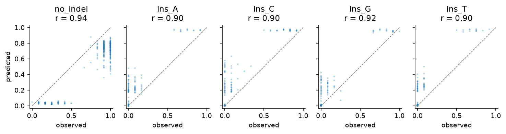
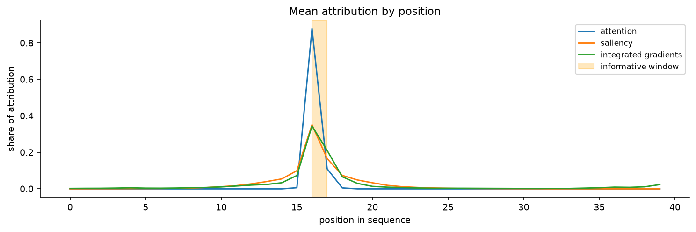

# CRISPR Repair Outcome Prediction

**An attention BiLSTM for DNA sequence classification, with a pipeline built so every claim can be checked.**


---

## Why this package exists

It is easy to build a sequence model, report an accuracy, and show an attention heatmap. It is much harder to know whether either number means anything.

Three things go wrong often, and none of them show up in the usual metrics:

| What goes wrong | What it looks like | What this package does |
|---|---|---|
| **Leakage** | Reads from one site land in both train and test. The score looks good. | Splits by site, then measures the inflation so you can see it. |
| **A flattering baseline** | 0.78 accuracy on data that is 78% one class. | Reports a majority baseline **and** a reachable ceiling, so the gap is real. |
| **An attention plot that is not real** | A clean heatmap that another random seed contradicts. | Scores attribution against a known answer, then refits across seeds to check it holds. |

This repository is a small, readable reference for doing those three things properly. The model is under 60,000 parameters. The point is the pipeline around it.

It also ships a command line predictor, so a trained model can be used outside the notebook that made it.

---

## Scope: this is not research data

> The data here is **synthetic**. It is generated by rules written into `crispr_attention/data.py`.
>
> That is on purpose. Because the informative positions are known in advance, every interpretation step is **scored against the right answer** instead of being read off a plot and believed.
>
> **No biological claim is made anywhere in this repository.** These notebooks test a pipeline. They do not test a hypothesis, and they contain no experimental data.

---

## Results

Two coarse tasks, then one at genotype resolution. `no_indel` dominates, so accuracy is always shown next to two reference points:

- **Majority baseline** is what you get by always guessing the most common class.
- **Group ceiling** is the best any per read model can do, because reads at one site share a sequence but not an outcome. This is the real target, not 1.0.

| | Deletion class | Insertion base |
|---|---|---|
| Sites / reads | 2,000 / 24,000 | 2,000 / 24,000 |
| Majority baseline | 0.4869 | 0.7806 |
| Group ceiling | 0.7436 | 0.9087 |
| **Read accuracy** | **0.5544** | **0.8781** |
| Headroom won | 26% | 76% |
| **Macro F1** (baseline) | **0.6024** (0.1310) | **0.7935** (0.1754) |
| Balanced accuracy | 0.8016 | 0.8517 |
| **Site level Pearson r** | **0.8274** | **0.9015** |

The site level row is the comparison the field actually makes. Published models predict the **distribution of outcomes at a site**, not a class for one read, because a per read label is only one draw from that distribution.



Each point is one site. The ranking is good, r of 0.90 or better. But the rare classes sit above the diagonal, so predicted frequencies run high. That is the cost of class weighted training, and notebook 03 measures it directly.

---

## The three findings worth reading

### 1. An attention heatmap can be pure noise

In the deletion notebook, one run gave a convincing attention plot: 9.2 fold enrichment, peak at position 21, inside the informative window.

Refitting on four seeds, with the data and settings fixed:

| Method | Peak inside the window | Enrichment range |
|---|---|---|
| Attention | **0 of 4 seeds** | 1.45 to 5.09 |
| Saliency | 4 of 4 | 3.52 to 5.33 |
| Integrated gradients | 4 of 4 | 5.40 to 7.79 |

Macro F1 moved only from 0.563 to 0.647 across those seeds. So performance was stable while the attention plot was not, and no performance metric would have warned you.

This is why the package ships three attribution methods and an `enrichment` score, not one heatmap.

### 2. Class weighting can make a model worse

The standard answer to imbalance is a class weighted loss. On the genotype task it does real damage. Same model, same split, nothing else changed:

| Metric | Unweighted | Class weighted |
|---|---|---|
| top 1 accuracy | **0.425** | 0.338 |
| top 3 accuracy | **0.978** | 0.681 |
| site Pearson r | **0.862** | 0.621 |
| site mean absolute error | **0.0035** | 0.0058 |
| macro F1 | 0.230 | **0.418** |

The split is clean. Weighting improves the metrics that average over classes. It degrades every metric that asks whether the actual outcome was predicted.

The reason is simple. Class weighting works by pushing predicted probabilities away from observed frequencies. Here the frequencies **are** what you are trying to estimate.

Taking the conventional option without checking would have given a better macro F1 and a worse model.

### 3. Some features a recurrent model just will not learn

The deletion notebook also runs a harder version of its own rule. When microhomology is a copy at a variable offset rather than a simple repeat, the same architecture on the same amount of data wins 1.9% of the available headroom instead of 26%.

That is reported as a table rather than dropped. It also explains a design choice in the literature: inDelphi and FORECasT enumerate candidate microhomologies as explicit features instead of asking a network to find them in raw sequence.

---

## The notebooks

All four are committed **with their outputs**, so you can read the figures and numbers without running anything.

| Notebook | What it covers |
|---|---|
| [`00_method_check.ipynb`](notebooks/00_method_check.ipynb) | The shortest test. Does attention find a known motif? |
| [`01_deletion_pipeline.ipynb`](notebooks/01_deletion_pipeline.ipynb) | Full pipeline, plus the seed stability result and the harder variant. |
| [`02_insertion_pipeline.ipynb`](notebooks/02_insertion_pipeline.ipynb) | Full pipeline on the task where attribution is clean. All three methods agree. |
| [`03_genotype_pipeline.ipynb`](notebooks/03_genotype_pipeline.ipynb) | 171 genotype classes, top k metrics, frequency prior baseline, the loss choice above. |

Each pipeline notebook runs the same steps: data, leakage check, split by site, training, evaluation at read and site level, three attribution methods, seed stability, export.



---

## Install

```bash
git clone https://github.com/<your-username>/crispr-repair-attention.git
cd crispr-repair-attention
pip install -r requirements.txt
```

CPU is enough. A GPU is used automatically if present.

---

## Use

### As a library

```python
import crispr_attention as ca

# A benchmark with a known answer
X, y, groups, CLASSES, cut = ca.make_insertion_task(n_groups=2000, per_group=12,
                                                    length=40, cut=20)

# Split by target site, never by read
train, val, test = ca.group_split(groups)

model = ca.AttentionBiLSTM(num_classes=len(CLASSES))
model, history = ca.fit(model, X[train], y[train], X[val], y[val],
                        epochs=40, patience=6, weight_decay=1e-4)

pred = ca.predict(model, X[test])
proba = ca.predict_proba(model, X[test])

# Read level, against the majority baseline
print(ca.summary(ca.evaluate(y[test], pred, y_train=y[train], target_names=CLASSES)))
print("reachable ceiling:", ca.bayes_ceiling(y, groups))

# Site level, the way published models report
print(ca.site_summary(ca.site_evaluate(proba, y[test], groups[test])))

# Where did it look, and is that a real signal
ig = ca.interpret.integrated_gradients(model, X[test], pred)
print("enrichment in the known window:",
      ca.interpret.enrichment(ig.mean(0), (cut - 4, cut - 2)))
```

For your own sequences, build the input with `ca.encode(seq, length=40)`. Give each read a group label so reads from one site stay on one side of the split.

### From the command line

```bash
python predict.py --model models/ins_model.pt \
                  --input examples/ins_sequences.csv --id-col id \
                  --output predictions.csv
```

```
id                   predicted_class  confidence  top_attended_position  p_no_indel  p_ins_A  ...
site856_read10280    ins_C                0.9603                     17      0.0390   0.0003
site51_read617       ins_T                0.9679                     16      0.0317   0.0001
```

FASTA works too. The window is part of the contract: these models expect the cut at position 20 of a 40 bp window. A sequence windowed any other way will score as noise.

---

## Layout

```
crispr_attention/
  model.py       AttentionBiLSTM, positional encoding, masked attention
  data.py        encoding, four benchmarks, split by group, bayes_ceiling
  train.py       training loop with early stopping, batched prediction
  evaluate.py    read and site metrics, top k, majority and prior baselines
  interpret.py   attention, saliency, integrated gradients, enrichment
  plots.py       confusion matrix, PR curves, heatmaps, site scatter, top k
notebooks/       four notebooks, committed with outputs
predict.py       command line scoring, CSV or FASTA
models/          trained checkpoints, with their test metrics inside
examples/        input and output for the predictor
docs/            figures used in this README
```

---

## Requirements for running this on real data

The pipeline is built to this specification. Each point is enforced in code rather than left to the user.

- **Window on the cut site, in reference coordinates.** Fixed length, cut at a known offset. `predict.py` records the window in the checkpoint and warns on a mismatch.
- **Treat the target site as the unit of learning.** Reads from one amplicon are near copies, so the number of sites is the effective sample size. `group_split`, `bayes_ceiling` and `site_evaluate` all follow from this.
- **Left align indels to one convention.** Microhomology makes placement ambiguous, so one outcome can be written several ways.
- **Keep indels within a window of the cut.** Events far away are more likely artifacts than repair products.
- **Predict from the unedited target sequence.** The input is the reference protospacer. The label is the outcome observed at it.
- **Predict the outcome distribution per site**, as inDelphi and FORECasT do. `site_evaluate` implements this.

---

## References

**Method**

- Hochreiter S. and Schmidhuber J. (1997). Long short-term memory. *Neural Computation* 9, 1735-1780.
- Bahdanau D., Cho K. and Bengio Y. (2015). Neural machine translation by jointly learning to align and translate. *ICLR*.
- Vaswani A. et al. (2017). Attention is all you need. *NeurIPS*.

**Interpretation and evaluation**

- Simonyan K., Vedaldi A. and Zisserman A. (2014). Deep inside convolutional networks. *ICLR workshop*.
- Sundararajan M., Taly A. and Yan Q. (2017). Axiomatic attribution for deep networks. *ICML*.
- Jain S. and Wallace B.C. (2019). Attention is not explanation. *NAACL-HLT*, 3543-3556.
- Saito T. and Rehmsmeier M. (2015). The precision-recall plot is more informative than the ROC plot on imbalanced datasets. *PLoS ONE* 10, e0118432.

**CRISPR repair outcomes**

- Bae S., Kweon J., Kim H.S. and Kim J.S. (2014). Microhomology based choice of Cas9 nuclease target sites. *Nature Methods* 11, 705-706.
- van Overbeek M. et al. (2016). DNA repair profiling reveals nonrandom outcomes at Cas9 mediated breaks. *Molecular Cell* 63, 633-646.
- Shen M.W. et al. (2018). Predictable and precise template-free CRISPR editing of pathogenic variants. *Nature* 563, 646-651. (inDelphi)
- Lemos B.R. et al. (2018). CRISPR/Cas9 cleavages in budding yeast reveal templated insertions. *PNAS* 115, E2040-E2047.
- Allen F. et al. (2019). Predicting the mutations generated by repair of Cas9-induced double-strand breaks. *Nature Biotechnology* 37, 64-72. (FORECasT)
- Chen W. et al. (2019). Massively parallel profiling and predictive modeling of the outcomes of CRISPR/Cas9-mediated double-strand break repair. *Nucleic Acids Research*. (Lindel)
- Liu X., Wang S. and Ai D. (2022). Predicting CRISPR/Cas9 repair outcomes by attention based deep learning framework. *Cells* 11, 1847. [doi:10.3390/cells11111847](https://doi.org/10.3390/cells11111847)

---

## Author

**Pragya Kesarwani** · [LinkedIn](https://www.linkedin.com/in/pragya-kesarwani-87242a3b/)

## License

MIT, see [LICENSE](LICENSE).
